# Pyre

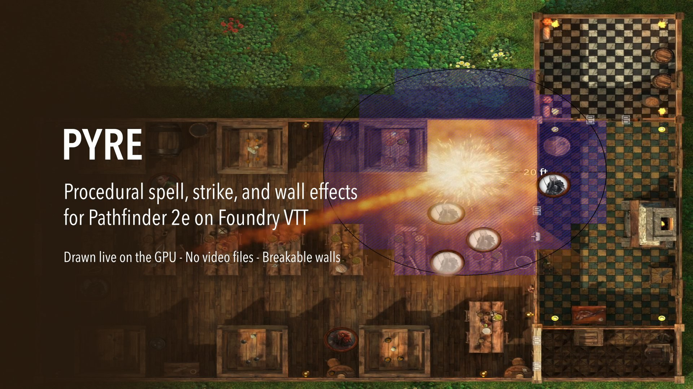

Procedural spell, strike and condition effects for **Pathfinder 2e** on **Foundry VTT V13 and V14**.

Everything is drawn live on the GPU from code (three.js, bundled locally). There are no video files, so the whole module is well under 1 MB, and every effect adapts to the spell, the weapon, the target and the map: fireballs fly and burst, breath weapons stop at walls, sparks bounce off them, swords leave cuts and axes leave gashes, and walls, doors and windows can break.

Pyre works on its own. You do not need Sequencer, JB2A or any asset pack.

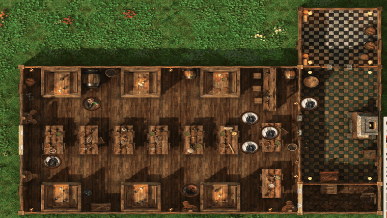

## Installation

In Foundry: **Add-on Modules → Install Module**, paste this manifest URL and click Install:

```
https://raw.githubusercontent.com/daember-rpg/pyre/main/module.json
```

Then enable **Pyre** in your world. Foundry tells you when an update is available.

## What plays, and when

| In the game | What Pyre shows |
| --- | --- |
| A spell's area is placed on the map (burst, cone, line, emanation, cylinder, square) | The area effect where it was placed |
| An area spell whose area is never placed, when damage is rolled at targets | The area aimed at those targets (setting *Areas that are never placed*) |
| An emanation | Plays at once around the caster |
| A spell attack (Ray of Frost, Hydraulic Push…) | Ray → impact, following the attack roll |
| A spell with a save and targets but no area (Electric Arc, Heal…) | A bolt or pulse on each targeted creature |
| A spell without damage (Haste, Fear, Mystic Armor…) | The tradition's circle on the caster, then a blessing, hex or self glow |
| A creature's breath weapon or other area ability | Recognised from the ability's own data: cone or line, element, size |
| Weapon, unarmed and NPC strikes | A signature per weapon group (see below), tinted by property runes |
| Conditions and spell effects on an actor | Lasting auras for the conditions that change how a creature looks (see below), persistent damage, Shield and Mystic Armor, the Light spell, and helpful or hindering spell effects |
| A creature summoned with Conjure (in development, see below) | Summon circle and arrival; dissolve on dismissal |

Effects are worked out from the item's data: area, defense, damage types, traits, weapon group and runes. Every client plays the same effect from the same seed, without sockets.

| A black dragon's Breath Weapon, read from the ability's text | Lasting auras on conditions and spell effects, and the Light spell |
| --- | --- |
| 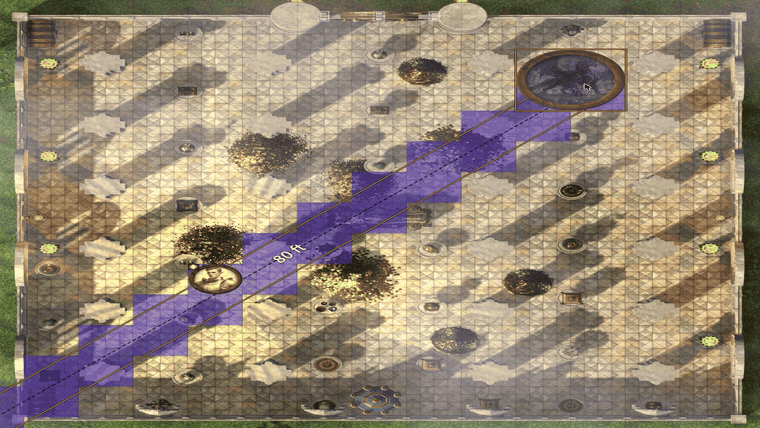 | 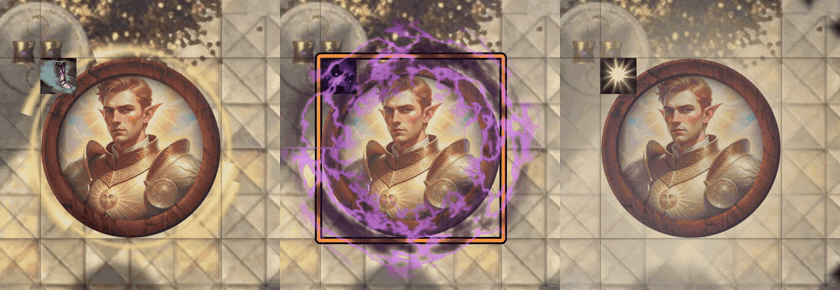 |

### Condition auras

Pyre gives a lasting aura to the conditions that change how a creature looks or moves. A creature shows its three most telling auras at once.

| Condition | Aura |
| --- | --- |
| Quickened | a gold ring with streaks racing around it |
| Slowed | a clock face with one slow hand |
| Frightened | dark violet wisps, and the token trembles |
| Sickened | a queasy green haze |
| Confused | little spirals wheeling over the head |
| Stunned | stars circling the head |
| Fascinated | slow hypnotic rings pulsing outward |
| Dazzled | white glints flashing around the head |
| Doomed | a dark shroud with red embers rising |
| Paralyzed | held still under a pale, glassy film |
| Petrified | grey stone with cracks over the whole token |
| Restrained, Grabbed | two chains crossing the token |
| Immobilized | roots holding the lower half |
| Invisible | a faint shimmer, seen only by the GM |
| Persistent damage | fire: flames · bleed: drops · acid: bubbling · cold: frost spikes and flakes · electricity: snapping arcs · poison: a heavy green mist |

Also: Shield, Mystic Armor and similar protections (a force bubble); the Light spell (a lantern glow at the feet); and other spell effects, as a blessing or a hex coloured by the caster's tradition.

Conditions that only change numbers or attitudes (off-guard, clumsy, enfeebled, drained, friendly, hostile and the like) are left without an aura on purpose, so the map stays readable. Visibility states (hidden, undetected, concealed) are left to Foundry.

### Strikes

Each weapon group has its own signature:

* **Sword:** an arc of steel and a cut across the target.
* **Axe:** a heavy chop that leaves a gash in the floor.
* **Dagger:** two quick stabs.
* **Flail and whip:** a lash and a crack.
* **Hammer, club and mace:** a shockwave of dust and pebbles.
* **Pick:** a star crack in the floor.
* **Polearm:** a long reap that pulls the target.
* **Spear:** a long thrust.
* **Shield:** a bash that pushes the target back.
* **Ranged:** bow, crossbow, sling, firearm (muzzle flash and smoke) and spinning thrown weapons.
* **Natural attacks:** punches, raking claws, biting jaws, tail sweeps.
* **Alchemical bombs.**

<p align="center">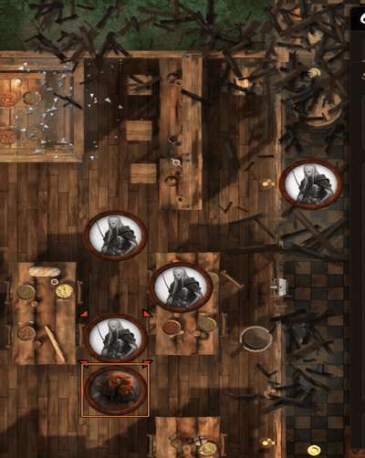</p>

Attacks are read in this order:

1. the GM's attack override;
2. the PF2e weapon group;
3. the attack's name (Claw, Jaws, Tail, Longsword…);
4. its traits and damage type.

Property runes add their look to any strike: flaming, frost, shock, corrosive, thundering, holy, unholy, astral, wounding, fearsome, ghost touch and speed. As in PF2e, a weapon holds one property rune per point of potency, up to three, and Pyre shows them all.

<p align="center">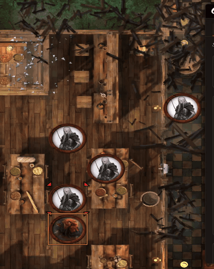</p>

### Walls

* **Walls stop areas** (world setting, on by default). Bursts, breaths and other areas stop at walls that block movement. Creatures behind a wall do not react, and sparks, flames and smoke bounce off it.
* **Breakable walls** (world setting, off by default). After an area's damage roll, the walls it reaches take the damage minus their Hardness, following PF2e's object rules. The GM picks which walls break in a short dialog.
  * A broken wall stops blocking. A collapse plays for everyone and rubble stays on the floor.
  * Doors burst into planks and windows shatter into glass.
  * Restore walls from the GM's chat card, from the Walls layer controls, or from Pyre Studio. The rubble flies back and the wall closes.
  * Each wall's material, Hardness and HP are set in the wall's own sheet: double-click a wall and use the **Pyre** section.
  * To set many at once, use the **Pyre: materials of many walls** button in the Walls layer controls. It changes the selected walls, or every wall, door or window in the scene, in one go.
  * Walls with no material of their own use the scene's default from Pyre Studio → Scene. Doors default to wood and windows to glass.
  * **Materials react to damage types:**

  | Material | Hardness / HP | Takes more | Takes less |
  |---|---|---|---|
  | Wood | 10 / 40 | fire ×2, acid and slashing ×1.25 | cold and piercing ÷2 |
  | Stone | 14 / 56 | sonic ×2, bludgeoning and acid ×1.5 | fire, cold, electricity, piercing and slashing ÷2 |
  | Iron / steel | 18 / 72 | acid ×2, cold ×1.5 | fire, electricity, piercing and slashing ÷2 |
  | Glass | 2 / 8 | sonic and bludgeoning ×2, cold ×1.5 | — |

  Force hits every material the same. Mental, spirit, poison, vitality, void and bleed damage do not harm walls.

| A red dragon's breath stops at the wall | The GM confirms, and the walls give way |
| --- | --- |
| 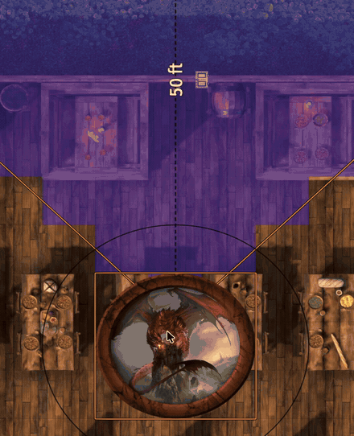 | 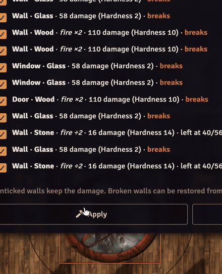 |

| A fireball breaks the walls it reaches | Restoring them: the rubble flies back |
| --- | --- |
| 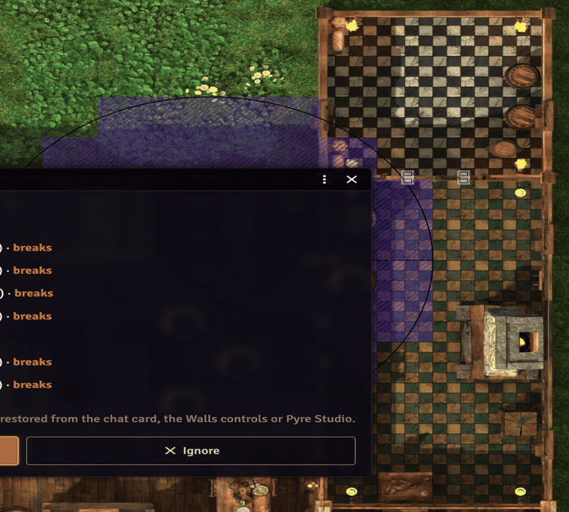 | 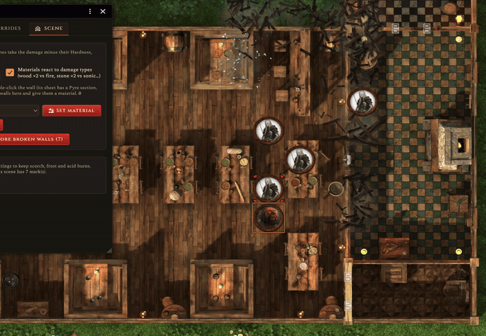 |

| Edit many walls at once | Each wall's own Pyre section |
| --- | --- |
| 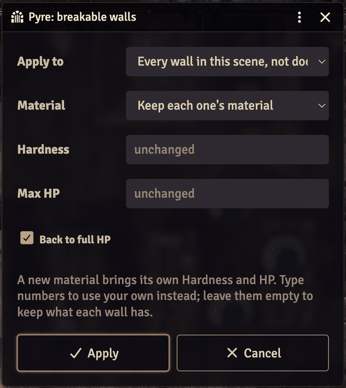 | 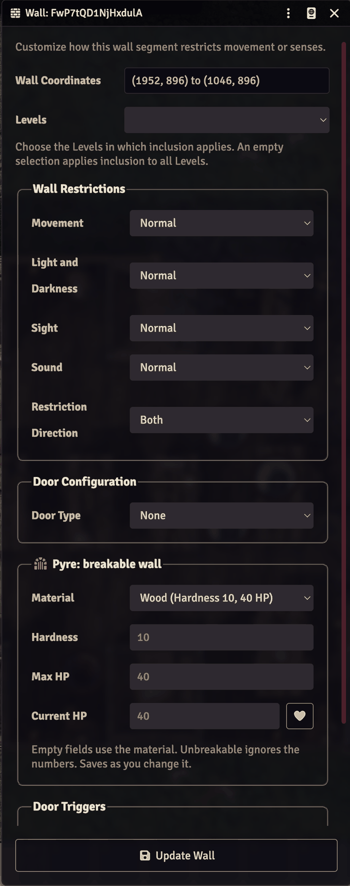 |

### Lasting marks

With **Lasting marks** on (world setting), area spells leave scorch, frost and acid burns on the map until you clear them in Pyre Studio → Scene. Rubble from broken walls is always kept until the wall is restored.

### Secret rolls

When an attack roll is blind or whispered, players see a neutral strike. It lands, but shows no hit, miss or critical, and no rune effects.

The GM sees the real result, plus **Replay as Miss / Hit / Critical** buttons on the chat card. Clicking one plays that result for everyone.

## Pyre Studio (GM)

Open it from the fire icon in the token controls, or from **Configure Settings → Pyre**.

* **Test on the map:** select a token, target others with T, and play any standard effect, strike or cast glow. Tests play only on your screen.
* **Overrides:**
  * change one spell's delivery, element, material or colours, or turn its animation off (an enemy's black lightning, an ice fireball…);
  * under **Attacks**, choose how any attack name looks, and add a rune look if you like.
* **Scene:**
  * the scene's default wall material and the damage-type rule;
  * set the material of selected walls, break them, or restore broken walls;
  * clear lasting marks.

| Test on the map | Overrides | Scene |
| --- | --- | --- |
| 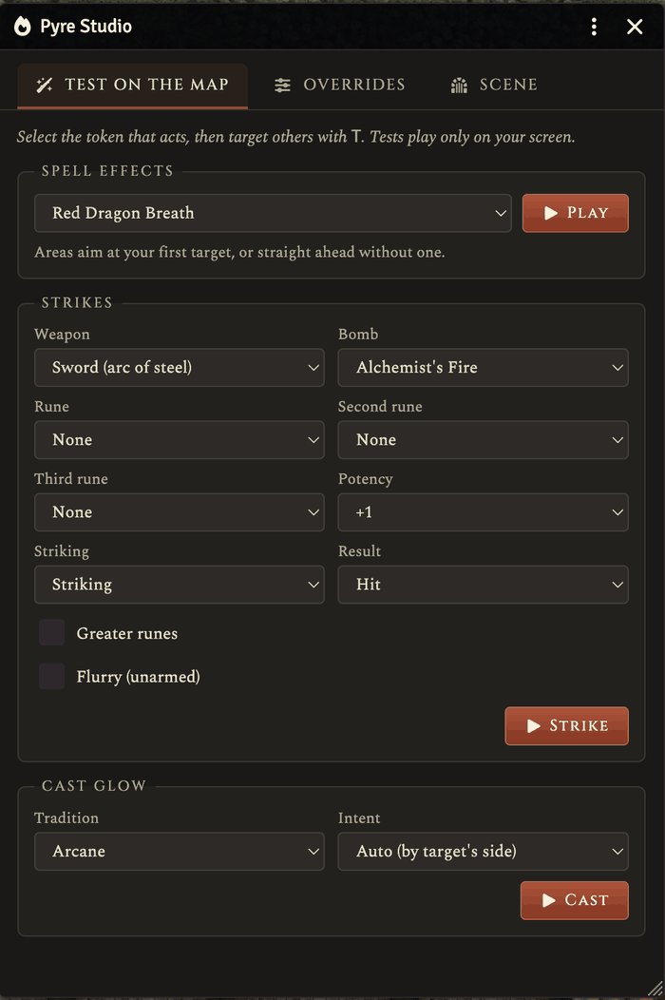 | 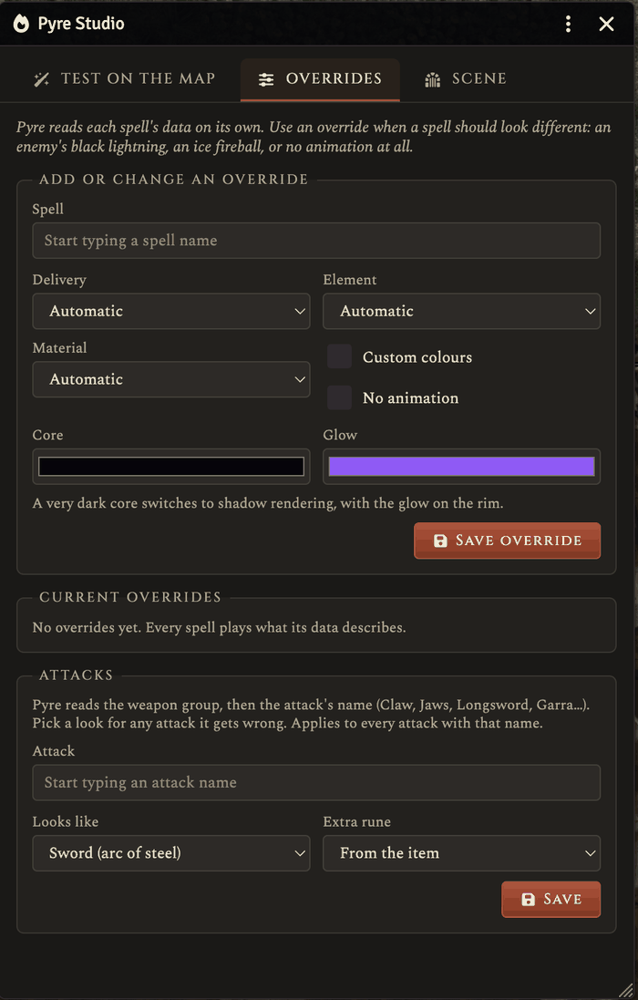 | 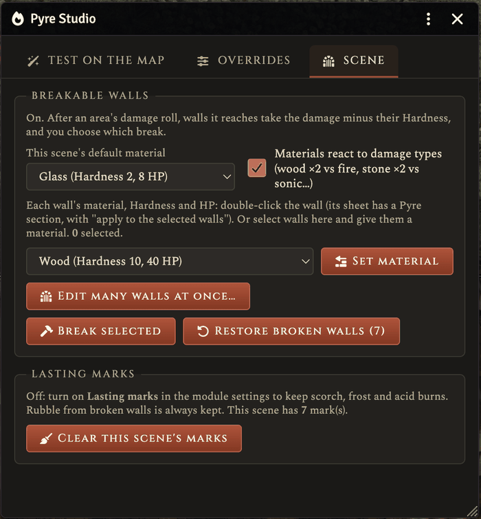 |

## Settings

| Each player | The world (GM) |
| --- | --- |
| Show effects | Walls stop areas |
| Quality (low, medium, high) | Breakable walls |
| Animation speed | Lasting marks |
| Adaptive resolution | |
| Brightness and glow | Animate spells |
| Screen shake and impact zoom | Animate strikes |
| Token reactions | Animate posted spell cards |
| Ground marks and how long they stay | Areas that are never placed |
| Smoke and dust duration | |
| Floor effects under tokens | |
| Casting circle size | |
| Condition auras (everyone, only my and allied tokens, off) | |
| Debug logging | |

**Debug logging** shows a small box with what Pyre decided for each attack and spell, and why. If it played nothing, the box says why. Turn it on when something looks wrong.

### Performance

Pyre only runs while an effect is playing. On older laptops, set **Quality** to Low. **Adaptive resolution** lowers the effects' resolution by itself when frames run long, and raises it again once they are quick.

## Translating Pyre

All text lives in `lang/en.json`. To translate:

1. Copy `lang/en.json` to your language, for example `lang/pt-BR.json`.
2. Translate the values. Keep the keys and the `{placeholders}` as they are.
3. Add the language to `module.json` under `languages`.

Any key you leave out falls back to English. Pull requests with translations are welcome.

## Compatibility

* Foundry VTT V13 and V14.
* Pathfinder 2e system; built and tested on 8.x.
* Works with PF2e's Regions for placed areas.
* **Conjure** is a summoning module of ours that is still in development and not yet public. Pyre already supports it: with both active, Conjure handles the summoning and Pyre draws it. It will be linked here once it is released.

## For developers

A small API is on `game.modules.get("pyre").api`. For example, `api.preset("std-fireball", caster, [target])` plays a standard preset from one token at others.

## Credits and license

Pyre is free. It is made by Fernando (daember-rpg), with Claude.

The code is released under the MIT License (see `LICENSE`). It bundles [three.js](https://threejs.org), also MIT (see `scripts/vendor/THREE-LICENSE.txt`).

Pathfinder is a trademark of Paizo Inc. Pyre is not published, endorsed or approved by Paizo.

See `CHANGELOG.md` for what changed in each version.
